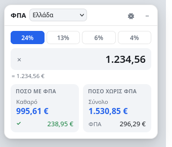

# ΦΠΑ quick calculator — Greek VAT userscript

A small always-available VAT (ΦΠΑ) calculator that lives in the bottom-right corner
of every page: type an amount and instantly see **Καθαρό / ΦΠΑ / Σύνολο** — for
**all 27 EU countries** (Greek 24 / 13 / 6 / 4 % by default).



No network calls, no analytics, no page modification — one shadow-DOM panel.

## Install

1. Install [Tampermonkey](https://www.tampermonkey.net/) (Firefox, Chrome, Edge, …).
2. Click **[Install greek-vat-calc.user.js](https://raw.githubusercontent.com/tasosxynos/greek-vat-userscript/main/greek-vat-calc.user.js)**
   — Tampermonkey shows its install page, press *Install*.

Future versions install themselves: `@updateURL` / `@downloadURL` point at this repo.

## What it does

| | |
|---|---|
| Panel | fixed bottom-right on every http(s) page, draggable by its header; minimizing returns it to the bottom-right corner, while a position you dragged to is kept (double-click the bar to re-dock) |
| Input | type any amount; both readings are shown at once, no mode switching |
| Left column | the amount is **με ΦΠΑ** (gross) → `ΦΠΑ`, `Σύνολο`, then the **`Καθαρό`** you are extracting (blue, bottom row) |
| Right column | the amount is **χωρίς ΦΠΑ** (net) → `Καθαρό`, `ΦΠΑ`, then the **`Σύνολο`** you are adding up (blue, bottom row) |
| Highlight | always the result row at the bottom of each column — never the amount you typed |
| Copy | click any of the six values to copy it as `1234,56` (comma decimal, no symbol) |
| Country | selector next to the rate: all **27 EU member states**, with the markets you order from on top (Ελλάδα, Γερμανία, Ιταλία, Ισπανία, Γαλλία, Ολλανδία, Πολωνία) |
| Rate | follows the country — its standard rate first, then that country's reduced rates (Ελλάδα: 24 / 13 / 6 / 4 %) |
| Memory | position, country and rate are remembered; folded/expanded follows the site (below) |

### Keyboard

| Key | Action |
|---|---|
| `Alt+Q` | focus the amount field (opens the panel if folded) |
| any digit (nothing focused on the page) | jumps straight into the amount field and types it |
| `Esc` | leave the field |
| double-click the bar | back to the default bottom-right corner |

### Where it opens by itself

The panel **starts minimized** everywhere, and unfolds by itself only on shopping sites, so
it never covers a page you are just reading:

- **e-shops it opens on:** Skroutz, BestPrice, e-shop.gr, Plaisio, Kotsovolos, Public,
  MediaMarkt, Germanos, You, Shopflix, Amazon (every Amazon domain), eBay, AliExpress, Temu,
  Shein, Zalando, IKEA, Saturn, Decathlon, Alibaba, Banggood, Walmart, Etsy, Zara.
- Switch to a **non-shop tab** and it folds itself back to the pill; land back on a shop page
  and it reopens. Fold it yourself and it stays folded, as you left it.
- Typing a digit on a page (nothing focused) opens it *and* starts the amount; `Alt+Q` always
  opens and focuses it.
- Add your own shop by appending its domain to `SHOPS` in the script: `'myshop.gr'`, or
  `'brand.'` to match every TLD of `brand`.

While the caret is in the amount field, keystrokes are stopped from propagating, so
page shortcuts (YouTube, Gmail, …) never fire.

### Number formats

Greek conventions are assumed: `,` is the decimal mark, `.` groups thousands.

| You type | Parsed as |
|---|---|
| `1.234,56` | 1234.56 |
| `1234,56` / `1234.56` | 1234.56 |
| `1.234` | 1234 |
| `€ 1.234,56` | 1234.56 |
| `124` | 124 |

The parsed value is echoed under the field (`= 1.234,56 €`), so a mis-parse is visible
immediately.

## Configuration

Edit the constants at the top of the script:

```js
const EU = [ ['AT', 'Αυστρία', 20, [13, 10]], /* … 27 entries … */ ];
const TOP = ['GR', 'DE', 'IT', 'ES', 'FR', 'NL', 'PL'];  // first in the country list
const HOTKEY = { alt: true, code: 'KeyQ' };              // Alt+Q
const QUICK_TYPE = true;                                 // type-a-digit-anywhere
```

## Countries & rates

Standard rates, as of **January 2026** (source: EU tables — TEDB / European Commission):

| | | | | | |
|---|---|---|---|---|---|
| AT 20 | BE 21 | BG 20 | HR 25 | CY 19 | CZ 21 |
| DK 25 | EE 24 | FI 25.5 | FR 20 | DE 19 | GR 24 |
| HU 27 | IE 23 | IT 22 | LV 21 | LT 21 | LU 17 |
| MT 18 | NL 21 | PL 23 | PT 23 | RO 21 | SK 23 |
| SI 22 | ES 21 | SE 25 | | | |

Reduced rates (also in the dropdown, grey-text extras such as 2.1 % FR / 3 % LU / 4 % ES-IT)
apply only to specific goods and services — check locally when it matters. Selecting a
country resets the rate to that country's standard rate.

## Development

The script is a single file, no build step. The maths/parsing core is marked
`// #region pure` … `// #endregion pure` so it can be tested standalone:

```bash
node tests/vat_test.mjs      # 33 assertions, no dependencies
```

## Notes / limits

- Userscripts do not run on `about:`, `file://`, or the built-in PDF viewer; the panel
  is hidden in fullscreen video.
- HTML/CSS/DOM only — nothing is sent anywhere.

## License

MIT — see [LICENSE](LICENSE).
